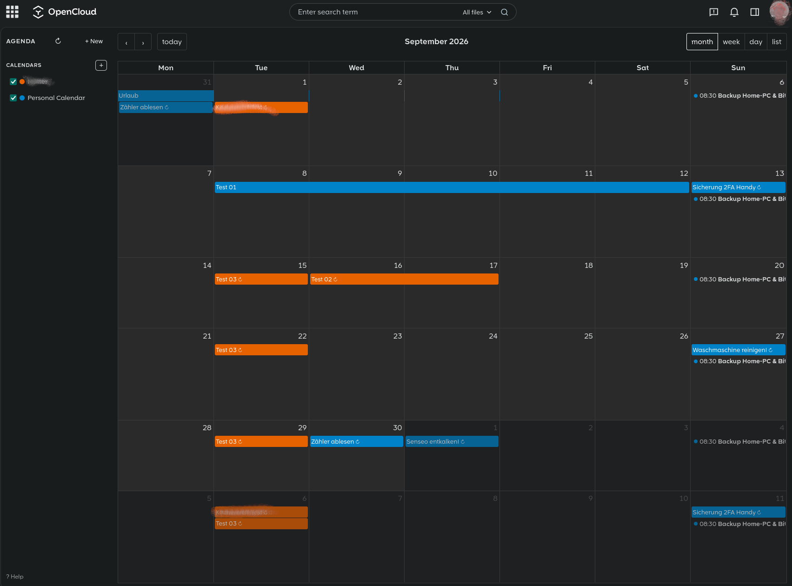

# opencloud-agenda

A CalDAV calendar web application for [OpenCloud](https://opencloud.eu) 8.x, built as a native web extension using the OpenCloud Extension SDK.

[](https://claude.ai) [](https://www.gnu.org/licenses/gpl-3.0)

> [!IMPORTANT]
> This project is an independent, community-built tool and is not affiliated with, endorsed by, or associated with the [OpenCloud project](https://opencloud.eu) in any way.

## Features

- **Month, week, day and list views** powered by [FullCalendar](https://fullcalendar.io/)
- **Create, edit and delete events** via a clean dialog — including drag & drop and resize
- **Recurring events** — create and edit series with full RRULE support (daily, weekly, monthly by day or Nth weekday, yearly; end by count or date); recurring events are marked with ↻
- **CalDAV sync** — compatible with Thunderbird, DAVx⁵ and other CalDAV clients; Thunderbird-created recurring events are correctly expanded and editable
- **Calendar management** — create calendars with custom colors, rename by double-click, show/hide per calendar
- **Move events between calendars** — change the calendar in the edit dialog
- **iCal subscriptions** *(experimental, requires additional server setup — see below)* — add external `.ics` calendars (public holidays, team calendars) as read-only feeds. Accepts plain `.ics` URLs, `webcal://` links, and Google Calendar "Add to Calendar" links (`?cid=…`)
- **Event overflow** — month view caps events per cell and shows a "+N more" link; clicking opens a popover with all events for that day
- **Manual refresh** — ↻ button in the sidebar reloads all data and subscriptions from the server on demand
- **Bilingual UI** — English and German, based on the browser/OpenCloud language setting
- **Dark mode support** — follows the OpenCloud theme
- **Secure token management** — app tokens are cached per tab in `sessionStorage` (24 h TTL), refreshed automatically on expiry, and revoked on the server at logout



> [!WARNING]
> **Back up your Radicale data before installing or upgrading.**  
> This app reads and writes calendar data directly via CalDAV. While it has been tested carefully, no software is free of bugs. A backup of your Radicale data directory ensures you can recover your calendars if anything goes wrong.

## Requirements

- OpenCloud 8.x with Radicale enabled (CalDAV at `/caldav/`)

## Installation

### Option A: Download the release zip (recommended)

1. Download and unzip the latest release (replace `v1.4.0` with the current version):

```bash
cd <opencloud-data>/web/assets/apps/
curl -L -O https://forgejo.linux-nerds.org/frank/opencloud-agenda/releases/download/v2.0.0/agenda-v2.0.0.zip
unzip agenda-v2.0.0.zip
rm agenda-v2.0.0.zip
```

This creates an `agenda/` folder containing the app files.

3. Fix ownership if you unzipped as root (replace `dockeruser` with your OpenCloud service user):

```bash
chown -R dockeruser:dockeruser <opencloud-data>/web/assets/apps/opencloud-agenda
```

4. Restart OpenCloud:

```bash
docker compose restart opencloud
```

The app registers itself automatically via the included `manifest.json` — no changes to OpenCloud config files required.

### Option B: Build from source

Requirements: Node.js 22+ and [pnpm](https://pnpm.io/) 11 (the exact version is pinned via `packageManager` in `package.json`; with Corepack enabled it is picked up automatically)

```bash
git clone https://forgejo.linux-nerds.org/frank/opencloud-agenda.git
cd opencloud-agenda
pnpm install
pnpm build
```

Copy the contents of `dist/` to:

```
<opencloud-data>/web/assets/apps/opencloud-agenda/
```

Then restart OpenCloud.

## Development

```bash
pnpm dev
```

Refer to the [OpenCloud web-app-skeleton](https://github.com/opencloud-eu/web-app-skeleton) for local development setup with Docker.

## Technical stack

| Library | Purpose |
|---|---|
| [Vue 3](https://vuejs.org/) | UI framework |
| [FullCalendar 6](https://fullcalendar.io/) | Calendar rendering |
| [ical.js](https://github.com/kewisch/ical.js/) | iCalendar parsing & RRULE expansion |
| [@opencloud-eu/web-pkg](https://github.com/opencloud-eu/web) | OpenCloud Extension SDK |
| [@module-federation/vite](https://github.com/module-federation/vite) | Module Federation build |
| [Vite 8](https://vite.dev/) | Build tool |

## Architecture notes

- Authentication uses the OpenCloud app token endpoint (`POST /auth-app/tokens`) with the OIDC Bearer token, then Basic Auth for CalDAV requests — identical to the contacts app pattern.
- App tokens are stored in `sessionStorage` keyed by user UUID (24 h TTL), so they never outlive the browser tab. Concurrent requests within a tab are deduplicated via a module-level in-flight promise map. A 401 response triggers an automatic token refresh. When OpenCloud Web clears the login session (logout), the app revokes its token via `DELETE /auth-app/tokens`; the same happens when the user changes.
- The Radicale CalDAV path uses the **user UUID** (not the username), as set by the OpenCloud proxy via `X-Remote-User`.
- FullCalendar icon fonts are replaced with Unicode characters to comply with the OpenCloud Content Security Policy (`font-src 'self'` — no `data:` URIs allowed).
- Recurring events are expanded client-side by ical.js (±2 years). Editing a recurring event uses GET → patch → PUT to preserve the RRULE and all other ICS properties.
- All ICS text values are RFC 5545-escaped; CalDAV XML payloads use proper XML entity escaping.
- ICS subscriptions are fetched server-side via a small Node.js proxy (`/ics-proxy/`) to avoid browser CORS restrictions. The proxy validates the user's Bearer token against OpenCloud and refuses targets on private, loopback, link-local or tunnelling (NAT64, Teredo, 6to4) addresses. The check runs inside the socket's own DNS lookup — not as a separate resolve beforehand — so a rebinding DNS server cannot answer differently to the check and the connection.
- Subscription responses are checked for a `BEGIN:VCALENDAR` prelude. A misrouted `/ics-proxy/` path answers HTTP 200 with the OpenCloud web SPA's `index.html`, which would otherwise parse to an empty event list and present a broken subscription as an empty but healthy one.

## Theming — read this before touching any colour

> [!IMPORTANT]
> **Never use `@media (prefers-color-scheme: …)` in this app, and never invent `--oc-color-*` variables.** Both were in here for a long time and made the light theme unusable. The details below explain why, so the mistake is not repeated.

OpenCloud publishes a Material-3 style set of **role tokens**:

```
--oc-role-surface            --oc-role-on-surface
--oc-role-surface-container  --oc-role-on-surface-variant
--oc-role-primary            --oc-role-on-primary
--oc-role-error              --oc-role-on-error
--oc-role-outline            --oc-role-outline-variant
…45 in total
```

Their values live in `/themes/opencloud/theme.json` under `clients.web.themes[].designTokens.roles`, one entry per theme, and OpenCloud **rewrites the custom properties in place** when the user switches theme.

Three consequences, each of which cost a bug:

1. **There is no theme class and no media query to hook into.** `.is-dark-mode` exists in OpenCloud's stylesheet but belongs to a single floating-action-button widget — it is not a global switch. Consuming the role tokens is the only way to follow the theme.
2. **`prefers-color-scheme` follows the operating system, not OpenCloud.** The two agree only by coincidence. OS dark plus OpenCloud light produced a white sidebar around a dark calendar grid.
3. **`--oc-color-*` does not exist.** Those names silently fall back to whatever literal is written after the comma, so the app looks fine in one theme and is quietly hardcoded in the other.

Pair every surface with its matching `on-` token — in the dark theme `primary` is a light blue (`#5cd5fb`) and white text on it is unreadable, which is exactly what `--oc-role-on-primary` (`#003543`) is for.

**Elevation steps** used here, chosen so the dark theme keeps a visible separation:

| Element | Token | light | dark |
|---|---|---|---|
| Dialog, page | `surface` | `#ffffff` | `#191c1d` |
| Inputs, secondary buttons | `surface-container-high` | `#f2f4f5` | `#272a2c` |
| Hover | `surface-container-highest` | `#eceef0` | `#323537` |

**FullCalendar** is themed through its own `--fc-*` variables, fed from the role tokens in `CalendarView.vue`. Watch for FullCalendar rules that need `!important` to override — the today marker used to carry a hardcoded brand blue that beat the variable.

**The today marker** is the day number itself: a filled pill in `primary` with `--oc-role-on-primary` digits, set in `CalendarView.vue` on `.fc-day-today .fc-daygrid-day-number`. The cell keeps a 14 % wash of `primary` as a secondary cue, and that 14 % is a ceiling, not a starting point — event chips sit on that cell and lose their contrast as the tint grows. A marker that is hard to see is fixed on the date, not by darkening the cell. Both values live next to each other; keep `--fc-today-bg-color` in step with the `.fc-day-today.fc-daygrid-day` rule, or the week and day views drift away from the month.

**Native controls** (date pickers, selects, scrollbars) obey the CSS `color-scheme` property, which takes a keyword, not a colour. `light dark` hands the choice back to the OS. `CalendarView.vue` therefore derives it from the resolved surface colour via `schemeForBackground()` and re-applies it with a `MutationObserver`, because OpenCloud signals a theme change only by rewriting the properties.

**Deliberately not themed:** the QR tile stays white (a dark tile swallows the quiet zone and phone cameras stop reading the code), modal scrims stay translucent black, and event resize grips stay translucent white because they sit on user-chosen calendar colours.

**Checking a change:** contrast is verifiable without a browser. Resolve every `background`/`color` pair in `dist/assets/*.css` against both palettes from `theme.json` and compute the WCAG ratio; the current build has 34 such pairs, all at or above AA 4.5:1. That catches unreadable combinations, but not spacing or aesthetics — click through both themes as well.

## Optional: iCal Subscriptions (Experimental)

> [!NOTE]
> This feature requires a small server-side proxy service. The base app works without it — subscriptions are simply not available unless the proxy is set up.

External `.ics` feeds cannot be fetched directly from the browser due to CORS restrictions. A lightweight Node.js proxy service handles this server-side.

> [!IMPORTANT]
> The proxy fetches URLs supplied by users from **inside** your Docker network, where service names like `opencloud:9200` and the cloud provider's metadata endpoint (`169.254.169.254`) are reachable. The `server.js` below therefore resolves every target hostname and refuses private, loopback, link-local and CGNAT addresses, re-checking after each redirect. Do not simplify that guard away — without it any authenticated user can read your internal services through the proxy.

The proxy lives in its own directory and its own Compose project, deliberately **outside** your OpenCloud compose directory, so that rebuilding or updating OpenCloud cannot remove it.

### Where subscriptions are stored, and what that means for other devices

Subscriptions are **not** CalDAV calendars. They are a list of feed URLs, kept as a single JSON file in your OpenCloud file storage:

```
/remote.php/dav/files/<userId>/.agenda/subscriptions.json
```

`localStorage` holds a copy as an offline cache. The events themselves are never stored — they are fetched from the remote feed each time the app loads.

This has one consequence worth knowing up front:

| Where | Subscriptions visible? |
|---|---|
| Agenda in any browser, any device, same account | **Yes** — the list is read from the server on every load |
| Thunderbird, DAVx⁵, phone calendar apps | **No** — those speak CalDAV to Radicale, where the subscriptions do not exist |

Radicale stores events; it does not fetch remote feeds. Putting subscriptions there would mean polling the source and writing the events into a Radicale collection, which needs a service that runs whether or not a browser is open — outside what a web app can do.

So to see the same feed elsewhere, subscribe to the `.ics` URL directly on that device. The sharing dialog exists to make that painless.

### Sharing a subscription: `webcal://` or `https://`

**Click a subscription's name** in the sidebar. The dialog shows a QR code, the feed URL and a copy button — plus a switch between two schemes.

**The switch is not a convenience. Neither scheme works everywhere:**

| Target | Needs | Why |
|---|---|---|
| Android — ICSx⁵, DAVx⁵ | `webcal://` | An `https://` QR is just a web link. The phone opens a browser and shows raw iCalendar text; nothing offers to subscribe |
| Thunderbird | `https://` | Rejects `webcal://` in the "New calendar → On the network" dialog |
| iOS | `webcal://` | Safari hands the scheme to Calendar, which prompts to subscribe |

Same feed, both spellings — only the scheme differs:

```
webcal://calendar.google.com/calendar/ical/<id>%40group.calendar.google.com/public/basic.ics
https://calendar.google.com/calendar/ical/<id>%40group.calendar.google.com/public/basic.ics
```

`webcal://` is the default because that is what the QR is for. Switch to `https://` when the target is a desktop client.

Two details the app handles for you:

- **Stored URLs always use `http(s)`** — that is what `fetch()` needs. The scheme is swapped only for what leaves the app.
- **Google feed URLs are rewritten to `calendar.google.com`.** Google hands them out under `www.google.com`, which answers `302` with an empty body. Clients that do not follow redirects would subscribe and then show nothing.

> [!TIP]
> If an Android subscription stays empty, read the status in ICSx⁵ first. **"Not synced yet"** means Android never ran the sync — check battery optimisation for ICSx⁵, then Settings → Accounts → "Auto-sync data". An actual error message means the URL is the problem. The two look identical in the calendar app and lead to completely different searches.

### 1. Create the proxy service

```bash
mkdir -p ~/ics-proxy/app && cd ~/ics-proxy
```

**`~/ics-proxy/app/package.json`**
```json
{
  "name": "ics-proxy",
  "version": "2.1.0",
  "type": "module",
  "main": "server.js"
}
```

**`~/ics-proxy/app/server.js`**
```js
import http from 'http'
import https from 'https'
import dns from 'dns'
import net from 'net'

const PORT = 3000
const PATH_PREFIX = '/ics-proxy/'
const OC_USER_URL = process.env.OC_USER_URL || 'http://opencloud:9200/ocs/v2.php/cloud/user'
const MAX_BYTES = 10 * 1024 * 1024   // refuse feeds larger than 10 MB
const MAX_REDIRECTS = 5
const TIMEOUT_MS = 10000

// ── SSRF guard ────────────────────────────────────────────────────────────────

// net.BlockList parses addresses into binary form before matching, so every
// spelling of the same address is caught: ::ffff:7f00:1 and ::ffff:127.0.0.1,
// 0:0:0:0:0:0:0:1 and ::1. A hand-written regex over the string misses those.
const blocked = new net.BlockList()
for (const [addr, prefix] of [
  ['0.0.0.0', 8],        // "this" network
  ['10.0.0.0', 8],
  ['100.64.0.0', 10],    // CGNAT
  ['127.0.0.0', 8],
  ['169.254.0.0', 16],   // link-local + cloud metadata
  ['172.16.0.0', 12],
  ['192.0.0.0', 24],
  ['192.168.0.0', 16],
  ['198.18.0.0', 15],    // benchmarking
  ['198.51.100.0', 24],  // documentation
  ['203.0.113.0', 24],   // documentation
  ['224.0.0.0', 3],      // multicast + reserved + broadcast
]) blocked.addSubnet(addr, prefix, 'ipv4')
for (const [addr, prefix] of [
  ['::', 128],           // unspecified
  ['::1', 128],          // loopback
  // No ::ffff:0:0/96 rule here: BlockList also matches plain IPv4 addresses
  // against the v6 rules in mapped form, so that entry would block all of
  // IPv4. Mapped addresses are handled explicitly in isPrivateAddress().
  ['64:ff9b::', 96],     // NAT64 — the embedded v4 may be private
  ['2001::', 32],        // Teredo — tunnels to an arbitrary v4 host
  ['2002::', 16],        // 6to4 — can wrap a private v4
  ['fc00::', 7],         // unique-local
  ['fe80::', 10],        // link-local
  ['fec0::', 10],        // site-local (deprecated, still routed by some stacks)
  ['ff00::', 8],         // multicast
]) blocked.addSubnet(addr, prefix, 'ipv6')

function isPrivateAddress(ip) {
  const family = net.isIP(ip)
  if (family === 4) return blocked.check(ip, 'ipv4')
  if (family === 6) {
    if (blocked.check(ip, 'ipv6')) return true
    // An IPv4-mapped address reaches the v4 host, so it must pass the v4 rules
    // too. SocketAddress canonicalises the spelling to ::ffff:a.b.c.d first.
    const canonical = new net.SocketAddress({ address: ip, family: 'ipv6' }).address
    const mapped = canonical.match(/^::ffff:(\d+\.\d+\.\d+\.\d+)$/)
    return mapped ? blocked.check(mapped[1], 'ipv4') : false
  }
  return true                                             // unparseable → refuse
}

// Checked at socket-connect time, not beforehand. A separate "resolve, check,
// then fetch" sequence resolves the name twice, and a DNS server with TTL 0 can
// answer a public address to the check and an internal one to the connection
// (DNS rebinding). Hooking the lookup the socket itself performs closes that gap:
// whatever address passes here is the address the socket connects to.
//
// All answers are inspected, not just the first — a host returning one public
// and one internal address must not slip through on the ordering.
function guardedLookup(hostname, options, callback) {
  dns.lookup(hostname, { ...options, all: true }, (err, addrs) => {
    if (err) return callback(err)
    if (!addrs.length) return callback(new Error('hostname does not resolve'))
    if (addrs.some(a => isPrivateAddress(a.address))) {
      return callback(new Error('target resolves to a private address'))
    }
    if (options.all) return callback(null, addrs)
    callback(null, addrs[0].address, addrs[0].family)
  })
}

// ── auth ──────────────────────────────────────────────────────────────────────

async function isAuthenticated(authHeader) {
  if (!authHeader) return false
  return new Promise((resolve) => {
    const req = http.get(OC_USER_URL, {
      headers: { Authorization: authHeader, 'OCS-APIRequest': 'true' }
    }, (res) => { res.resume(); resolve(res.statusCode === 200) })
    req.on('error', () => resolve(false))
    req.setTimeout(3000, () => { req.destroy(); resolve(false) })
  })
}

// ── upstream fetch ────────────────────────────────────────────────────────────

// Plain http/https instead of fetch(): only the low-level request exposes the
// `lookup` option that guardedLookup needs. A literal IP in the URL never hits
// the resolver, so it is checked directly.
function requestOnce(url) {
  if (!['http:', 'https:'].includes(url.protocol)) throw new Error('only http/https allowed')
  const literal = url.hostname.replace(/^\[|\]$/g, '')
  if (net.isIP(literal) && isPrivateAddress(literal)) throw new Error('target resolves to a private address')

  return new Promise((resolve, reject) => {
    const mod = url.protocol === 'https:' ? https : http
    const req = mod.request(url, {
      method: 'GET',
      headers: { 'User-Agent': 'opencloud-agenda-ics-proxy/2.1', 'Accept': 'text/calendar, text/plain;q=0.5' },
      lookup: guardedLookup,
      signal: AbortSignal.timeout(TIMEOUT_MS),
    }, resolve)
    req.on('error', reject)
    req.end()
  })
}

// Redirects are followed by hand so every hop goes through requestOnce() and
// its guards. Automatic following would let a public URL bounce straight to
// an internal one.
async function fetchFeed(startUrl) {
  let url = new URL(startUrl)
  for (let hop = 0; hop <= MAX_REDIRECTS; hop++) {
    const res = await requestOnce(url)
    if (res.statusCode >= 300 && res.statusCode < 400 && res.headers.location) {
      url = new URL(res.headers.location, url)
      res.resume()                                        // discard the redirect body
      continue
    }
    return res
  }
  throw new Error('too many redirects')
}

// Streams the body so an oversized feed is aborted instead of buffered whole.
async function readCapped(res) {
  const declared = Number(res.headers['content-length'])
  if (Number.isFinite(declared) && declared > MAX_BYTES) {
    res.destroy()
    throw new Error('calendar too large')
  }
  const chunks = []
  let total = 0
  for await (const chunk of res) {
    total += chunk.length
    if (total > MAX_BYTES) {
      res.destroy()
      throw new Error('calendar too large')
    }
    chunks.push(chunk)
  }
  return Buffer.concat(chunks)
}

// ── server ────────────────────────────────────────────────────────────────────

http.createServer(async (req, res) => {
  try {
    if (req.method !== 'GET' && req.method !== 'HEAD') {
      res.writeHead(405, { 'Allow': 'GET, HEAD' }); res.end('Method not allowed'); return
    }
    if (!req.url.startsWith(PATH_PREFIX)) {
      res.writeHead(404); res.end('Not found'); return
    }
    if (!await isAuthenticated(req.headers['authorization'])) {
      res.writeHead(401, { 'WWW-Authenticate': 'Bearer' })
      res.end('Unauthorized')
      return
    }

    // decodeURIComponent throws URIError on malformed input such as "%ZZ" —
    // uncaught this takes the whole process down.
    let targetUrl
    try {
      targetUrl = decodeURIComponent(req.url.slice(PATH_PREFIX.length))
    } catch {
      res.writeHead(400); res.end('Invalid URL encoding'); return
    }
    try {
      new URL(targetUrl)
    } catch {
      res.writeHead(400); res.end('Invalid URL'); return
    }

    let upstream, body
    try {
      upstream = await fetchFeed(targetUrl)
      body = await readCapped(upstream)
    } catch (err) {
      res.writeHead(502, { 'Content-Type': 'text/plain; charset=utf-8' })
      res.end('Upstream error: ' + err.message)
      return
    }

    // The upstream Content-Type is deliberately discarded. Echoing it would let
    // any user serve HTML from your OpenCloud origin through this path.
    res.writeHead(upstream.statusCode, {
      'Content-Type': 'text/calendar; charset=utf-8',
      'X-Content-Type-Options': 'nosniff',
      'Content-Security-Policy': "default-src 'none'; sandbox",
      'Content-Disposition': 'attachment; filename="calendar.ics"',
      'Cache-Control': 'private, max-age=3600',
    })
    res.end(req.method === 'HEAD' ? undefined : body)
  } catch (err) {
    if (!res.headersSent) { res.writeHead(500); res.end('Internal error') }
    console.error('unhandled:', err?.message)
  }
}).listen(PORT, () => console.log('ICS proxy listening on port ' + PORT))
```

### 2. Create the Compose project

**`~/ics-proxy/compose.yaml`** — adjust `Host(...)` to your domain, and the two network names to match your setup (`docker network ls`):

```yaml
services:
  ics-proxy:
    image: node:20-alpine
    container_name: ics-proxy
    restart: always
    working_dir: /app
    command: node server.js
    user: "1000:1000"
    read_only: true
    mem_limit: 256m
    pids_limit: 128
    cap_drop: [ALL]
    security_opt:
      - no-new-privileges:true
    volumes:
      - ./app:/app:ro
    networks:
      - traefik-public
      - opencloud-net
    labels:
      traefik.enable: "true"
      traefik.docker.network: "traefik-public"
      traefik.http.routers.ics-proxy.rule: "Host(`cloud.example.org`) && PathPrefix(`/ics-proxy/`)"
      traefik.http.routers.ics-proxy.priority: "100"
      traefik.http.routers.ics-proxy.entrypoints: "https"
      traefik.http.routers.ics-proxy.tls.certresolver: "letsencrypt"
      traefik.http.routers.ics-proxy.service: "ics-proxy"
      traefik.http.routers.ics-proxy.middlewares: "ics-ratelimit"
      traefik.http.services.ics-proxy.loadbalancer.server.port: "3000"
      traefik.http.middlewares.ics-ratelimit.ratelimit.average: "30"
      traefik.http.middlewares.ics-ratelimit.ratelimit.burst: "60"
      traefik.http.middlewares.ics-ratelimit.ratelimit.period: "1m"

networks:
  traefik-public:
    external: true
  opencloud-net:
    name: opencloud-compose_opencloud-net
    external: true
```

Three labels are load-bearing:

- **`priority: 100`** — outranks the catch-all OpenCloud router on the same host, which would otherwise swallow `/ics-proxy/` and answer with the web SPA's `index.html`.
- **`traefik.docker.network`** — the container sits in two networks; without this Traefik may pick the wrong one.
- **`PathPrefix`** — keeps the proxy on the same origin as the app, which is what `useSubscriptions.ts` expects (it calls `/ics-proxy/` relatively).

### 3. Start it

```bash
cd ~/ics-proxy && docker compose up -d && docker compose logs ics-proxy
```

Verify from outside — an unauthenticated request must be refused by the proxy itself, not answered with HTML:

```bash
curl -si https://cloud.example.org/ics-proxy/ | head -3
# HTTP/2 401
# www-authenticate: Bearer
```

If you get `HTTP/2 200` and an HTML body instead, the route is not reaching the container and the request is falling through to OpenCloud.

### Security notes

- Every request is authenticated against OpenCloud before anything is fetched, so the proxy is not an open relay for the internet at large.
- The remaining exposure is to **authenticated users** of your instance: they choose the URL that gets fetched. The SSRF guard is what contains that. Treat the proxy's trust level as "any account on your OpenCloud can reach these targets".
- The guard resolves DNS and then fetches by hostname, so a hostile nameserver could in principle answer differently for the two lookups (DNS rebinding). Closing that fully requires pinning the connection to the validated IP; for an instance with a known set of users this is generally an acceptable residual risk.

## License

This project is licensed under the **GNU General Public License v3.0**.  
See [LICENSE](LICENSE) for the full license text.
